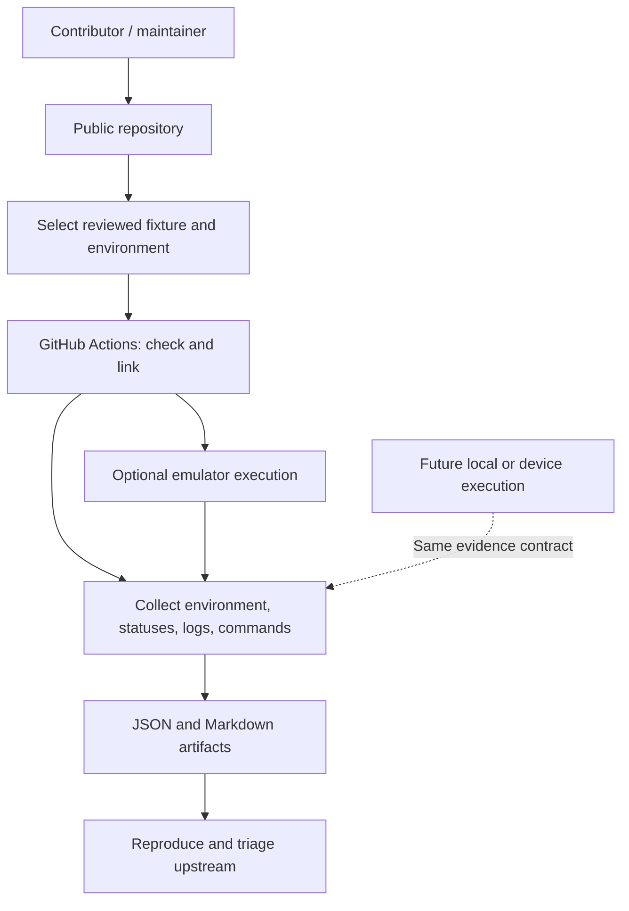

# High-Level Design — ohos-rs Pulse

**Version:** 1.1 Draft  
**Date:** 2026-10-14  
**Owner:** Project maintainers  
**Status:** Proposed — not an implementation claim

## 1. Purpose and problem

The project provides reproducible, auditable evidence for specific Rust usage scenarios on OpenHarmony. GitHub Actions is the initial execution entry point. The lasting output is evidence that developers can inspect, reproduce, and use when reporting or fixing problems.

A successful type check does not establish that an artifact can link, execute, or be used from ArkTS. Results also depend on dependency versions, features, SDK, target, and execution environment. A useful report must state exactly what was tested and what each outcome establishes.

The initial objective is to complete one small fixture for `libc`, from a versioned scenario through real build evidence and a readable report. A `napi-ohos` fixture is the next candidate for testing the Rust-to-ArkTS path after that workflow is usable. These are sequential objectives, not two simultaneous release requirements.

## 2. Users and goals

The first users are Rust developers and crate maintainers investigating a concrete OpenHarmony failure. The next users are application developers integrating Rust through ohos-rs and ArkTS. The project must help them answer: what was tested, under which conditions, what failed, and how can I reproduce it?

- **G1:** Define bounded, reproducible scenarios using versioned fixtures and test manifests.
- **G2:** Distinguish check, build/link, runtime, and ArkTS integration evidence for the declared artifact and usage context.
- **G3:** Automate initial validation on standard GitHub-hosted runners, with explicit outcomes when runtime execution is unavailable.
- **G4:** Preserve exact inputs, environment identity, commands, logs, and assertion evidence.
- **G5:** Support manual upstream triage first, then comparable baseline analysis when enough trustworthy results exist.
- **G6:** Keep the workload sustainable for one part-time maintainer; prove one fixture before expanding the matrix or framework.

## 3. Non-goals for the initial release

- Certifying a whole crate, all its features, or the entire Rust ecosystem as compatible.
- Reimplementing Rust, SDK installation, cargo-ohos, ohos-rs, device transport, or emulators.
- Scanning crates.io or automatically executing arbitrary submitted dependencies.
- Requiring multiple crates, multiple SDKs, multiple targets, or ArkTS integration for the first release.
- Operating a database, API service, dashboard, private CI repository, or self-hosted runner.
- Automatically filing upstream issues or declaring root causes from log keywords.

## 4. Evidence scope and execution paths

Every conclusion applies only to a declared combination of scenario, fixture contents, dependency graph, resolved features, artifact kind, target, toolchain, SDK, and relevant runtime environment. It does not establish coverage of untested APIs or transfer automatically to another architecture, distribution, or application context.

Two execution paths are relevant:

| Path | Artifact and environment | Evidence boundary |
|---|---|---|
| Standalone Rust scenario | An executable using the selected crate, run in a specified OpenHarmony environment | Assertions about the selected APIs in that process context |
| ArkTS application scenario | A Rust shared library packaged and loaded by a specified ArkTS application | Assertions about module loading, calls, and later selected callbacks or lifecycle behavior |

These paths share stage names, but are not interchangeable. A standalone executable passing does not prove that a shared library will work inside an application sandbox. A raw `dlopen` test does not establish Node-API initialization or an ArkTS call. ArkTS integration includes its own runtime execution evidence; stages are evidence categories rather than a universal four-step certification ladder.

## 5. System context

Standard GitHub-hosted Actions is the initial automated executor. The result contract must not depend on GitHub-specific identifiers being available: local reproduction uses the same fixture and records its own environment.

The emulator action documents a Linux CI flow with an Oniro x86_64 image. This makes hosted runtime execution a candidate worth testing, not a demonstrated project capability. Oniro evidence must be labeled with the actual distribution and image; it must not be presented as validation of every OpenHarmony or HarmonyOS device. See the [emulator action documentation](https://github.com/openharmony-rs/emulator-action).

Local or device execution can be added later through the same evidence contract if a concrete need appears. There is no initial commitment to build or operate a separate lab service.

## 6. Logical responsibilities

| Responsibility | Contract | Initial approach |
|---|---|---|
| Test manifest | What to test: fixture, scenario, selected features, artifact kind, prerequisites | Small versioned definition |
| Environment profile | Where and how to test: SDK, toolchain, target, runtime requirements | One pinned candidate configuration |
| Executor | Invoke existing tools; collect commands, exit status, timeouts, and logs | Simple scripts or a small CLI |
| Evidence collector | Store normalized stage outcomes and their supporting evidence | Schema-versioned JSON |
| Report | Explain coverage, outcomes, limitations, and reproduction | Markdown and CI artifacts |
| Baseline selection | Choose trusted historical evidence and check comparability | Manual initially; automated later |

These are responsibility boundaries, not requirements for separate packages or services. Start with the smallest implementation that can produce real evidence. Extract reusable orchestration only after repeated execution demonstrates a need.

Manifests, environment profiles, and baselines are distinct: test intent should not change merely because a new historical result is selected as a baseline.

## 7. Stage acceptance and statuses

| Stage | Acceptance criterion |
|---|---|
| `check` | Dependency resolution and target type checking succeed for the declared fixture targets and features, including the scenario code |
| `link` | The declared executable or shared library is produced successfully; its architecture and declared dependency expectations are checked and recorded |
| `runtime` | In the declared guest/process context, the intended scenario actually executes and all required assertions pass |
| `integration` | In the declared ArkTS application, the module is imported and the specified call and result assertions pass; additional behaviors require separate scenarios |

Check and link must use consistent fixture targets and feature selections. An empty project, zero matching tests, or a normal exit without the required assertion evidence cannot satisfy a runtime scenario.

A shared library may legitimately contain symbols resolved by other libraries or its loading environment. Symbol inspection supports diagnostics; a blanket requirement for zero undefined symbols is not the link acceptance criterion. Successful linking does not establish successful loading.

Allowed statuses:

- `passed`: the stage met its declared acceptance criterion with evidence.
- `failed`: the stage executed and failed its criterion; root cause may remain unknown.
- `blocked`: a required predecessor failed or a declared prerequisite is unavailable; record the cause.
- `not_run`: the stage was not scheduled or is not implemented; record the reason.
- `infra_error`: execution infrastructure failed, such as SDK setup or emulator startup.
- `timed_out`: the stage exceeded its budget; attribution remains open.

A link failure blocks dependent execution. An emulator startup failure is an infrastructure outcome, not proof of crate incompatibility. Assertion failures are evidence about the tested scenario, not automatic platform-wide conclusions. Retries must retain earlier attempts and must not erase failures.

## 8. Initial fixture: libc

`libc` exposes raw platform API bindings, making it a useful first subject for a small executable with explicit native calls. See the [upstream project](https://github.com/rust-lang/libc). The fixture tests a pinned upstream crate release; it does not implicitly test OpenHarmony's separately packaged or patched copy.

Start with one scenario: create a temporary file in a writable test directory, write known bytes through selected `libc` APIs, read them back, assert the contents, close descriptors, and clean up. The fixture must invoke the APIs being tested rather than rely on Rust standard-library operations as substitute coverage. Setup and cleanup failures must be visible.

This bounds the first result to selected declarations, linked symbols, and file I/O behavior. It does not establish completeness of the bindings, ABI correctness of every structure, or correctness of all system calls. Check alone cannot establish that the bindings match the SDK headers.

Only after this scenario produces useful evidence should additional scenarios be considered, such as epoll or memory mapping. ABI layout checks against SDK headers are a separate possible extension. Claims about musl fork compatibility, missing shared-memory functions, or ioctl differences require exact versions and reproducible evidence before inclusion as project findings.

A failure in one libc API can affect dependent use cases, but does not imply that the entire Rust ecosystem is unusable.

## 9. Next fixture candidate: napi-ohos

After the libc workflow is usable, evaluate one minimal Rust-to-ArkTS scenario using `napi-ohos` and its required companion crates and tooling. The [ohos-rs project](https://github.com/ohos-rs/ohos-rs) documents this integration path. Exact package versions, minimum Rust version, SDK requirements, and build commands must be checked for the selected release and pinned together.

The first scenario exports a synchronous `add(u32, u32)` function, builds the shared library, packages it in a minimal application, imports it from ArkTS, and asserts a known result. Successful shared-library creation is link evidence; application loading and the asserted ArkTS call are integration evidence.

Before committing this fixture to automated execution, verify that the selected image or device supports the required ArkTS/Node-API environment and that application build, signing where required, installation, launch, and assertion collection are reproducible. Availability of `hdc` alone does not establish these capabilities. Until then, report unexecuted stages explicitly.

Callbacks, asynchronous execution, buffers, and lifecycle behavior are later scenarios. This fixture is one selected integration route; it is not a claim that napi-ohos is the only possible Rust application integration mechanism.

## 10. Initial environment and CI policy

- **Repository:** one public GitHub repository.
- **Host:** standard `ubuntu-24.04` GitHub-hosted runner.
- **First target:** `x86_64-unknown-linux-ohos`, aligned with the candidate emulator image. Rust documents this target alongside aarch64 and armv7 in its [OpenHarmony platform support](https://doc.rust-lang.org/rustc/platform-support/openharmony.html).
- **SDK candidate:** release 6.1, subject to verifying the exact SDK package, API level, and guest compatibility. Record the observed metadata rather than assuming release and API mappings.
- **Dependency selection:** one pinned libc release and one feature configuration, with a committed fixture lockfile and locked builds.
- **Runtime candidate:** a pinned Oniro image through emulator-action, evaluated independently before becoming a required check.

Pin reviewed tool versions and Action commit SHAs. Record SDK package identity and image digest where available. Do not add aarch64 results until that target is actually built or executed; x86_64 success cannot substitute for them.

PR checks validate host code and test definitions. Cross-build checks become required after they are reliable. Runtime starts as a manual experiment and can become scheduled after repeatable success. If runtime is blocked, publish bounded check/link evidence and the blocker; do not introduce self-hosted infrastructure automatically.

## 11. Evidence, comparison, and upstream triage

Each scenario result records source commit, fixture content identity, lockfile hash, exact dependency versions and resolved features, artifact kind, target, Rust and build-tool versions, SDK identity, commands, per-stage statuses, and distinct log/artifact references. Runtime evidence also records image identity, OS build, and process/application context. Attempts must remain distinguishable.

Repository commits provide provenance; fixture content identity provides a comparison boundary. A documentation-only commit should not invalidate otherwise comparable fixture evidence.

A baseline is a versioned selection of trusted prior evidence. Compare results only when the relevant scenario, fixture, dependencies, features, toolchain, build tools, SDK, target, artifact kind, and runtime context match. A comparable `passed` to `failed` transition is a regression candidate requiring review. Intentional upgrades are separate version comparisons with declared changed dimensions, not identical-environment regressions.

Initial triage is manual. Reports should provide a minimal reproduction, exact environment, expected and actual behavior, and diagnostic references. A later export command may draft an upstream issue for human review. Automatic issue submission is outside the initial scope.

## 12. Security and storage

Untrusted fixture code and Rust build scripts execute only in disposable CI environments with read-only repository permissions and no injected secrets. Do not build untrusted PR code through privileged pull_request_target workflows or grant write permissions to unvalidated artifacts.

Store schema-versioned JSON, Markdown, and necessary logs as workflow artifacts; do not commit every generated run to main. Reports must explain artifact retention limits. Validate and escape public report content, and remove sensitive data from logs before publication.

## 13. First release acceptance

- One pinned libc fixture defines at least one meaningful scenario with explicit assertions.
- A real CI run produces check and link outcomes for one SDK and target, with commands and diagnostics. Any failure is reported without a compatibility claim; the intended build path has either succeeded or has a reproducible blocker.
- A runtime experiment records a real outcome or an explicit reason it was not run. A failed or unavailable runtime does not prevent publishing a clearly labeled check/link-only release.
- Schema-versioned JSON and Markdown distinguish stages and identify the precise tested configuration.
- Another developer can follow the documented prerequisites and commands to reproduce the scenario and inspect the evidence.
- No second crate, automated regression engine, or ArkTS application is required for this release.

This gate establishes a usable evidence workflow. It does not certify libc or require a positive compatibility outcome.

## 14. Risks and expansion gates

| Risk | Response or expansion gate |
|---|---|
| Hosted emulator is slow or unreliable | Measure real startup and execution behavior; retain check/link delivery and explicit runtime limitations |
| Tests are shallow or claims too broad | Require executed assertions and display tested API/scenario coverage |
| libc introduces unsafe test bugs | Keep the first scenario small; review pointer, buffer, descriptor, and cleanup handling |
| ArkTS packaging dominates maintenance | Evaluate a minimal application only after the first evidence workflow is usable |
| Matrix grows beyond capacity | Add one scenario or dimension at a time, based on user value and measured maintenance effort |
| Results cannot be compared or reproduced | Preserve exact inputs and environment identity before adding automation |

The next expansion decision is whether napi-ohos integration provides more value than strengthening libc runtime coverage. Make that decision from actual findings and available execution environments. Tokio, reqwest, rusqlite, additional architectures, historical dashboards, and automated baselines remain future candidates without a committed schedule.

## 15. Related documents and open decisions

The active initial scope and execution contracts are defined in the [MVP design](mvp/README.md).

Detailed designs will be written as implementation needs emerge from the MVP experiments.

Open decisions are the project license, the first pinned dependency/toolchain/SDK combination, actual emulator feasibility, and the environment for a later ArkTS application fixture. Resolve these through focused experiments rather than assumed compatibility.

## 16. Tool references

- [cargo-ohos](https://github.com/openharmony-rs/cargo-ohos)
- [setup-ohos-sdk](https://github.com/openharmony-rs/setup-ohos-sdk)
- [ohos-test-runner](https://github.com/openharmony-rs/ohos-test-runner)
- [emulator-action](https://github.com/openharmony-rs/emulator-action)
- [ohos-rs](https://github.com/ohos-rs/ohos-rs)
- [libc](https://github.com/rust-lang/libc)
- [Rust OpenHarmony platform support](https://doc.rust-lang.org/rustc/platform-support/openharmony.html)
